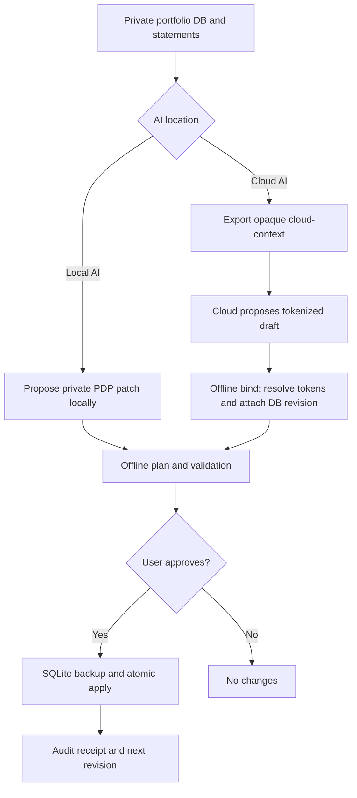

# LocalDelta

**Private AI-assisted incremental updates for local data.**  
**本地优先、AI 无关、可审计的增量更新系统。首个可运行适配器：投资组合。**

LocalDelta lets you keep your database on your own machine while asking a **local or cloud AI** to suggest structured changes. An offline importer validates the change package before committing anything. **The database is never uploaded or synchronized by this software.**

> **Status: alpha (v0.3.0).** The portable patch engine and privacy bridge are implemented for an existing three-table portfolio SQLite schema. The generalized database-adapter interface, full foreign-exchange cash ledger, and automated OCR are *roadmap*, not currently implemented.

> **v0.3.0: Multi-currency sidecar shipped.** PDP/2.0 stores typed decimal values in their original currencies (CNY, USD, HKD, etc.) and records dated, sourced FX observations. It does *not* provide full double-entry trading accounts, actual FX cash-leg reconciliation, or tax-lot accounting. See [multi-currency architecture](docs/MULTICURRENCY.md).


## Multi-currency quick start

Existing SQLite portfolios need a one-time explicit upgrade with a backup:

```bash
python localdelta.py money-upgrade --db private/portfolio.sqlite3
python localdelta.py money-report --db private/portfolio.sqlite3 --currency CNY --as-of 2026-11-09
```

The GUI has a **多币种** tab for upgrading legacy databases, preparing manually sourced exchange-rate patches, and computing dated portfolio reports. New databases created through the GUI enable multicurrency by default. For the CLI, use `create --db ... --multi-currency`. Never enter a made-up exchange rate as a factual bank rate. Foreign and CNY values are never summed without recorded conversion evidence. Reports flag missing snapshots or FX rates as **incomplete**.

Cloud drafting now supports `LocalDeltaDraft/2` with `money` roles, and local binding creates PDP/2.0 packages. The older CNY-only Draft/1 and PDP/1.0 flows remain supported on upgraded databases. See [PDP/2.0](docs/MULTICURRENCY.md) and the [Draft/2 schema](cloud_draft_v2.schema.json).

## What problem does it solve?

You collect transaction screenshots, CSV statements and account snapshots. Instead of repeatedly replacing your database, an AI produces a small **delta**. LocalDelta verifies identities, versions, types, decimal amounts, asset references, duplicate business events, provenance and transaction consistency. The actual write happens **locally in one SQLite transaction**, after an optional dry run and before-write backup.

**An AI is a proposal generator, not the database administrator.** It cannot ship SQL through the patch protocol.

## Two ways to use it

| Path | What the AI can see | Local workflow |
|---|---|---|
| **Local AI (maximum privacy)** | Only what you expose to your locally running model | Parse original private source material on your machine → generate a native PDP patch → `plan` → `apply` |
| **Cloud AI (selective disclosure)** | Only an opaque asset-token context **plus any new facts you independently choose to send** | `cloud-context` → ask AI for a `LocalDeltaDraft/1` → `bind-draft` offline → `plan` → `apply` |

The cloud context **does not contain** portfolio names, accounts, balances, holdings, transactions, or database fingerprints. It uses HMAC-generated opaque asset tokens and an HMAC context token. The secret key stays local. The optional `alias-map` command generates a separate sensitive name/token lookup for **local viewing only**; never upload it. **This is data minimization, not cryptographic computation on private data:** if you provide cloud AI with an unredacted screenshot or a dollar amount, that content is disclosed to the cloud provider.

## Architecture



## Easy desktop and terminal workflows (v0.2.1)

**GUI** — native Tkinter/ttk, optional, no web server or pip dependencies. On Windows, you can also double-click `Start-LocalDelta.cmd`; on Linux/macOS run `sh Start-LocalDelta.sh`:

```bash
python localdelta.py gui                  # create or open a database; no demo by default
python localdelta.py gui --db portfolio.sqlite3
python localdelta.py gui --show-demo      # developer-only demo controls
```

For real work, click **New database** to create and initialize an empty portfolio database, or open an existing one. Select a PDP patch, review every field change, and type `APPLY` to confirm. The importer revalidates before applying. The synthetic **Try demo** button appears only with `python localdelta.py gui --show-demo`. You can also export an opaque cloud context, bind a cloud draft locally, and review recent audited packages from the same window.

**Terminal** — interactive menu or a single guarded command:

```bash
python localdelta.py menu                 # interactive: status, import, context, draft
python localdelta.py demo                 # new isolated synthetic DB + matching patch
python localdelta.py update --db portfolio.sqlite3 --package update.pdp.zip
```

`update` always previews and prompts for literal `APPLY`; it refuses to write when standard input is non-interactive, unless `--yes` is **explicitly** passed. The low-level `plan`, `apply`, `init`, `status`, `restore` commands remain available and unchanged. No implicit database uploads or automatic confirmation.

Both clients use `workflow.py` and the existing `pdp.py` validation engine. Tkinter is usually installed with Python but some Linux installations need a separate `python3-tk` OS package. The terminal remains usable without Tk. Shell examples use `python`, or substitute `python3` where necessary.

See [user guide](docs/USER_GUIDE.md) and [Chinese introduction](README.zh-CN.md).

## Create a private database without demo data

Launch `python localdelta.py gui` and choose **新建数据库… (New database)**, or create one directly from a terminal:

```bash
python localdelta.py create --db private/portfolio.sqlite3 --multi-currency
python localdelta.py status --db private/portfolio.sqlite3
```

The creator builds the supported three-table portfolio schema, initializes PDP metadata, and checks database integrity. The result is empty (`assets=0`, `transactions=0`, `snapshots=0`). **Existing files are never overwritten.** GUI demos are hidden by default; `python localdelta.py gui --show-demo` is an explicit developer/testing option. `python localdelta.py demo` remains a separate terminal-only demonstration. The cloud privacy bridge currently cannot create the first asset in an empty database; a native local PDP package is required.

## Quick start (Python 3.10+, no third-party runtime dependencies)

```bash
# Clone once the repository is published, or unzip the source release.
python localdelta.py --help
python -m unittest discover -s tests -v

# With your OWN existing portfolio database:
python localdelta.py init --db /private/path/portfolio.sqlite3
python localdelta.py status --db /private/path/portfolio.sqlite3
```

### Cloud AI route (without exposing the local database)

```bash
# 1. Produce opaque asset references: safe by default; NO asset names.
python localdelta.py cloud-context --db portfolio.sqlite3 --out cloud-context.json

# 1b. OPTIONAL: view a PRIVATE token/name lookup locally (NEVER upload it).
python localdelta.py alias-map --db portfolio.sqlite3 --out private-aliases.json

# 2. Share cloud-context.json and only the new, preferably redacted facts
#    that you WANT a cloud AI to see. Ask for a LocalDeltaDraft/1 JSON file.

# 3. Resolve token aliases and bind the draft to the actual local database.
python localdelta.py bind-draft --db portfolio.sqlite3 --draft draft.json --out update.pdp.json

# 4. Review a dry run, then commit.
python localdelta.py plan --db portfolio.sqlite3 --package update.pdp.json
python localdelta.py apply --db portfolio.sqlite3 --package update.pdp.json
python localdelta.py status --db portfolio.sqlite3
```

An entirely synthetic end-to-end example is provided:

```bash
python examples/quickstart.py
```

**Supported cloud draft operations today:** create a new transaction or valuation snapshot attached to an **existing** asset. Creating a new asset, correcting old values and voiding erroneous records are supported by the *native local PDP patch* but are **not yet** supported by the privacy bridge. Those operations should currently be prepared locally and submitted through the same guarded importer. The private `localdelta.py context` / `pdp.py context` legacy command exports asset names and transaction references; **never upload its output expecting anonymity**. Use `cloud-context` for cloud collaboration.

### Local AI route

A local model can read your existing portfolio and documents under your own access controls, then produce a PDP/1.0 patch as specified in [PDP protocol](docs/PDP_SPEC.md). It can be applied through the same `plan` / `apply` commands, with no need for cloud context. **LocalDelta does not bundle an LLM, OCR engine or agent runtime**; you choose a model or an extraction program.

## Safety properties

- **No remote API calls** in the importer or privacy bridge.
- **No model-authored SQL** and only a bounded allowlist of tables, columns and operations.
- **Idempotency:** one package cannot be applied twice; source keys and business-key checks also detect duplicates.
- **Optimistic concurrency:** database revision + full data digest; corrected fields require expected previous values.
- **Atomicity:** the entire package commits or rolls back; before-apply SQLite backup, JSON receipt and audit tables.
- **Money transport:** decimal strings, not JSON floats. Legacy portfolio storage uses SQLite `REAL`; see [limitations](docs/PORTFOLIO_ADAPTER.md).
- **Privacy:** cloud aliases are pseudonymous, derived using an HMAC key never included in exports. See [threat model](docs/PRIVACY.md).
- **No invisible auto-approval:** source claims marked `confirmed` reflect user/source review, **not AI certification**. Inspect `plan` output before applying.

## Repository structure

```text
localdelta.py                 CLI: native PDP + menu/update/gui dispatch
terminal_ui.py                Interactive terminal menu + guarded one-step update
workflow.py                   Shared validation/review/commit orchestration
desktop_gui.py                Native Tkinter desktop UI
pdp.py                        Offline Portfolio Delta Protocol v1/v2 engine
multicurrency.py              Additive migration, typed money, dated FX, reports
privacy_bridge.py             HMAC pseudonyms and local draft binding
legacy_schema.sql             Synthetic-compatible portfolio adapter layout
pdp_package.schema.json      Native PDP package format schema
cloud_draft.schema.json      Cloud AI Draft/1 schema
cloud_draft_v2.schema.json   Typed multi-currency Draft/2 schema
examples/                    Synthetic demonstration only; no real holdings
scripts/check_public_tree.py  Public-repository secret/file guard
scripts/publish-to-github.* Guarded publisher (after creating empty GitHub repo)
.github/workflows/ci.yml     Cross-platform unit tests and public-file check
docs/                        Protocol, threat model, adapter constraints, roadmap
```

## Important limitations

The portfolio adapter still preserves legacy **CNY**-named `REAL` columns for backward compatibility, but PDP/2.0 writes new foreign monetary values exclusively to typed `ld_currency_amounts`. The controlled migration backfills legacy amounts and flags approximations from old SQLite floating-point storage. Full double-entry FX trading accounts and general-purpose adapters remain future work. A hash alone does not authenticate an AI or financial institution. Your local SQLite file and before-write backups are **not encrypted by the tool**; rely on disk encryption and private folder permissions.

**Never commit real databases, backups, screenshots, statements, contexts or update packages to a public Git repository.** This project is intentionally shipped with synthetic examples and source code only.

## Documentation

- [Desktop and terminal user guide](docs/USER_GUIDE.md)
- [Practical local/cloud AI collaboration prompts](docs/AI_WORKFLOW.md)
- [Cloud vs local AI and privacy boundaries](docs/PRIVACY.md)
- [PDP/1.0 portfolio patch specification](docs/PDP_SPEC.md)
- [PDP/2.0 multicurrency extension](docs/MULTICURRENCY.md)
- [Current portfolio adapter constraints](docs/PORTFOLIO_ADAPTER.md)
- [Implementation roadmap](docs/ROADMAP.md)
- [Security policy](SECURITY.md)

## Credits and references

This is an independent implementation, inspired by [RFC 6902 JSON Patch](https://www.rfc-editor.org/rfc/rfc6902), [SQLite Session Extension](https://www.sqlite.org/sessionintro.html), [SQLite transactions](https://www.sqlite.org/lang_transaction.html), and [SQLite backup API](https://sqlite.org/backup.html). It does **not** claim format compatibility with those systems.

Licensed under [MIT](LICENSE).

## Updating / republishing source code

Maintainers can use the optional guarded publisher to submit changes to their own GitHub fork or repository. Before pushing, review staged changes, ensure no personal files are tracked, and run all tests:

```powershell
# Windows: requires Python + Git; prompts before public push.
.\scripts\publish-to-github.ps1
```

```bash
# macOS / Linux
bash scripts/publish-to-github.sh
```

Both scripts stage only files not excluded by `.gitignore`, run the public-file audit, list the exact staged files and require typing `PUBLISH` before creating a commit and pushing. Your GitHub authentication and an existing empty repository are required.
